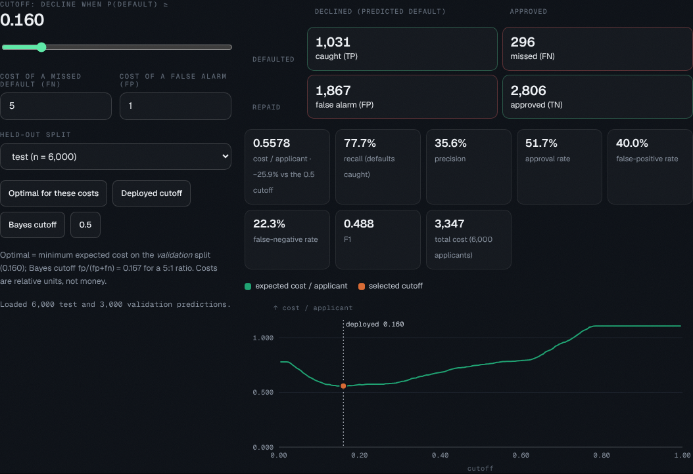
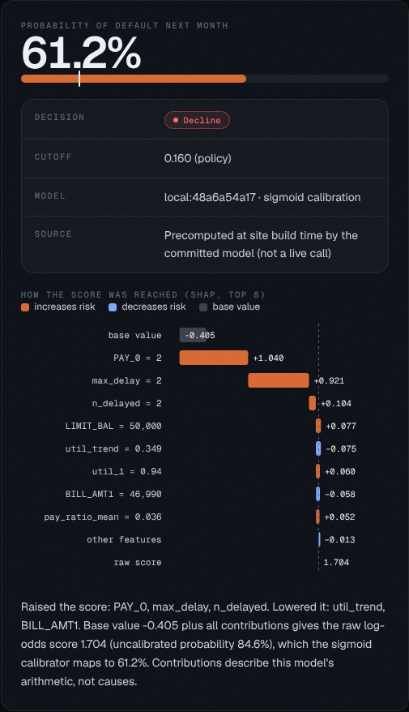
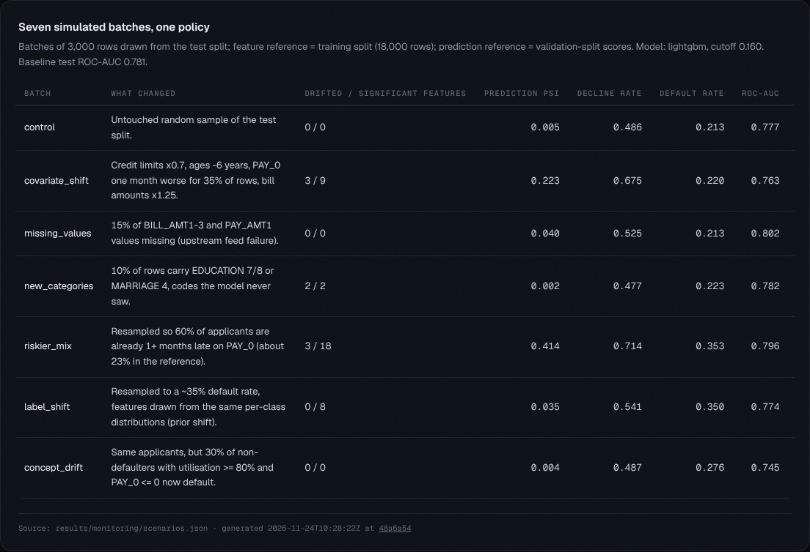
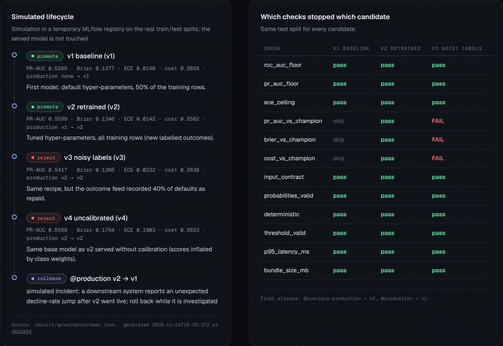
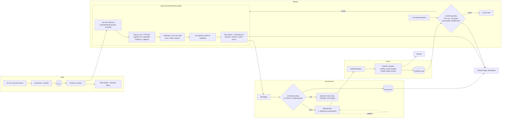

# credit-default-mlops

[](https://github.com/srini2k03/credit-default-mlops/actions/workflows/ci.yml)
[](https://github.com/srini2k03/credit-default-mlops/actions/workflows/train.yml)
[](https://github.com/srini2k03/credit-default-mlops/actions/workflows/pages.yml)
[](https://github.com/srini2k03/credit-default-mlops/actions/workflows/benchmark.yml)

Credit-card default prediction run as a complete ML lifecycle: validated and versioned data,
five model families compared under one protocol, calibrated probabilities, a **cost-sensitive
decision engine**, **champion/challenger governance** with a multi-check promotion gate and
rollback, drift monitoring with an explicit action policy, group-level fairness reporting, a
hardened FastAPI service, serving benchmarks, and a static dashboard rebuilt by CI.

> Educational decision-support project on a public 2005 dataset. Costs are stated assumptions in
> relative units; expected-cost changes are model-evaluation quantities, not financial savings,
> and nothing here is an approved lending or credit-scoring system.

**Data:** [UCI Default of Credit Card Clients](https://archive.ics.uci.edu/dataset/350/default+of+credit+card+clients)
(Yeh & Lien, 2009; CC BY 4.0). 30,000 Taiwanese card holders, 23 input columns, 22.1% default rate.

## Live links

| What | Where |
|---|---|
| Dashboard | https://srini2k03.github.io/credit-default-mlops/ (overview, [predict](https://srini2k03.github.io/credit-default-mlops/predict.html), [evaluation](https://srini2k03.github.io/credit-default-mlops/evaluation.html), [monitoring](https://srini2k03.github.io/credit-default-mlops/monitoring.html), [registry](https://srini2k03.github.io/credit-default-mlops/registry.html)) |
| API (Swagger UI) | https://credit-default-api-fkqg.onrender.com/docs (Render free tier: the first request after idle takes 30-60 s; checked by the `live-smoke` workflow) |
| Container image | `ghcr.io/srini2k03/credit-default-mlops:latest` (pushed by `ci.yml` on `main`) |

## Headline results

All numbers come from committed files written by CI runs on the real data; the source is given
next to each. Test split n = 6,000, never used for training, calibration, cutoff choice or
model selection.

| What | Result | Source |
|---|---|---|
| Champion | LightGBM, Platt (sigmoid) calibration, cutoff 0.16 | `results/metrics.json`, train run [45371941736](https://github.com/srini2k03/credit-default-mlops/actions/runs/45371941736) |
| Ranking | ROC-AUC 0.781 [0.766, 0.795], PR-AUC 0.559 [0.534, 0.585] (bootstrap 95% CI) | same |
| Calibration | Brier 0.1346, ECE 0.015 (uncalibrated: 0.1766 / 0.190) | same |
| Decision at FN:FP = 5:1 | expected cost per applicant 0.558 vs 0.752 at the 0.5 cutoff (−25.9%); default recall 35.4% → 77.7% | `results/decision.json` |
| Model comparison | LightGBM, random forest, XGBoost and CatBoost are within each other's CIs; logistic regression is clearly worse (PR-AUC 0.474) | `results/metrics.md` |
| Promotion gate | new champion passed all 12 checks against the previous production model (PR-AUC 0.536 → 0.559, cost 0.5625 → 0.5578) | `results/gate.md` |
| Governance simulation | baseline and retrained candidates promoted; a 40%-label-noise candidate and an uncalibrated candidate rejected; rollback restored the previous version | `results/governance/demo.md` |
| Drift policy | 7 simulated batches: control → no action; broken feed and new category codes → blocked; prior shift and concept drift → retrain once labels arrive | `results/monitoring/scenarios.md` |
| Serving | fast scoring path bit-identical to the sklearn pipeline on all 6,000 test rows; single-row p50 6.69 → 0.93 ms; one uvicorn worker, 4 clients: 102.6 → 330.3 req/s, p95 51.2 → 14.8 ms | `results/benchmarks/benchmark.md`, run [45375530277](https://github.com/srini2k03/credit-default-mlops/actions/runs/45375530277) |
| Load test | Locust, 20 users, 60 s against the Docker image: 4,842 requests, 0 failures, p95 210 ms | `results/loadtest.md` |

Full model-comparison table (written by `train.yml`):

<!-- RESULTS:START -->
Real UCI data (30,000 rows, default rate 22.1%), test holdout n = 6,000. Generated 2026-11-24T10:28:04Z by the [train workflow run](https://github.com/srini2k03/credit-default-mlops/actions/runs/45371941736) at commit `48a6a54`. Costs FN:FP = 5:1.

| Model | ROC-AUC [95% CI] | PR-AUC [95% CI] | F1 | Brier | Cost / applicant | Threshold |
|---|---|---|---|---|---|---|
| logreg | 0.733 [0.716, 0.750] | 0.474 [0.450, 0.500] | 0.459 | 0.144 | 0.620 | 0.11 |
| random_forest | 0.779 [0.765, 0.793] | 0.555 [0.530, 0.581] | 0.482 | 0.136 | 0.562 | 0.14 |
| **lightgbm** (champion) | 0.781 [0.766, 0.795] | 0.559 [0.534, 0.585] | 0.488 | 0.135 | 0.558 | 0.16 |
| xgboost | 0.780 [0.765, 0.794] | 0.555 [0.528, 0.581] | 0.503 | 0.136 | 0.569 | 0.17 |
| catboost (research only) | 0.782 [0.768, 0.796] | 0.563 [0.538, 0.588] | 0.504 | 0.135 | 0.559 | 0.17 |

Champion at different decision thresholds (test holdout):

| Threshold rule | Threshold | Cost / applicant | Recall | Approval rate | F1 |
|---|---|---|---|---|---|
| cost-optimal | 0.16 | 0.558 | 0.777 | 0.517 | 0.488 |
| 0.5 | 0.50 | 0.752 | 0.354 | 0.883 | 0.464 |
| max-F1 | 0.33 | 0.629 | 0.512 | 0.798 | 0.534 |

Imbalance ablation (CV PR-AUC on the training split):

| Model | none | class_weight | smote |
|---|---|---|---|
| logreg | 0.513 | 0.512 | 0.514 |
| random_forest | 0.567 | 0.567 | 0.554 |
| lightgbm | 0.563 | 0.565 | 0.559 |
| xgboost | 0.567 | 0.568 | 0.549 |
| catboost | 0.563 | 0.566 | 0.558 |
<!-- RESULTS:END -->

## Screenshots (real data, captured from the built dashboard)

| Decision slider on real held-out predictions | Prediction with SHAP waterfall (precomputed by the committed model) |
|---|---|
|  |  |
| **Drift scenarios and policy actions** | **Champion/challenger simulation** |
|  |  |

MLflow UI screenshots (runs table and registry aliases) are captured by `pages.yml` and shown on
the [registry page](https://srini2k03.github.io/credit-default-mlops/registry.html).

## Architecture



Design notes and the reasoning behind each choice are in [`docs/`](docs/):
[architecture](docs/architecture.md) · [data](docs/data.md) · [modelling](docs/modelling.md) ·
[decision engine](docs/decision_engine.md) · [governance](docs/governance.md) ·
[monitoring](docs/monitoring.md) · [fairness](docs/fairness.md) · [API](docs/api.md) ·
[performance](docs/performance.md) · [interview notes](docs/interview_notes.md).

## How each part works

| Stage | Implementation |
|---|---|
| Ingest | `credit_default.data.download`: UCI zip, then two commit-pinned mirrors; one canonical CSV whose sha256 is pinned in `configs/data/uci.yaml`; DVC (`dvc.yaml`, `dvc.lock`). |
| Validation | Pandera contract (`credit_default.validation`): strict columns, types, domains incl. the undocumented codes, ranges, unique IDs, default-rate bounds. A violation stops the pipeline. |
| Data quality | `credit_default.data.quality` → `results/data_quality.md`: duplicates, undocumented codes, outliers, domain flags, distributions, and leakage checks (disjoint splits, row-wise features, univariate ROC-AUC screen, train/test feature-vector overlap: 11 of 6,000 test rows). |
| Split | Stratified, seeded 60 / 10 / 10 / 20 (train / calibration / validation / test). The data has no application date (every row covers April-September 2005), so a temporal split is impossible; metrics measure in-period generalisation ([docs/data.md](docs/data.md)). |
| Features | Row-wise `FeatureBuilder` inside the model pipeline (utilisation, payment ratios, delay counts). SEX, MARRIAGE and AGE are excluded from model inputs (`features.exclude`); the API still accepts them and the fairness report uses them. |
| Models | LogReg, random forest, LightGBM, XGBoost (deployable) and CatBoost (compared, not deployable). Optuna TPE on stratified 3-fold CV PR-AUC, 30 trials each; imbalance ablation (none / class weights / SMOTE inside the folds). |
| Calibration | Per family: none, Platt and isotonic fitted on the calibration split; the lowest validation Brier wins. Platt won for every tree family; isotonic's ties cost 0.026 PR-AUC on the champion. |
| Selection | Champion = lowest expected cost on validation among deployable families (PR-AUC breaks ties). ROC-AUC is never used to choose. Paired bootstrap differences are published. |
| Decision engine | `credit_default.decision.engine`: configurable FN/FP costs, fixed cutoff or minimum approval rate; threshold rules compared on test; sensitivity of the optimal cutoff to FN:FP from 1:1 to 20:1 with the regret of the deployed cutoff. |
| Explainability | SHAP (TreeExplainer / LinearExplainer) global, dependence and waterfall plots; per-request ranked contributions with direction and the raw-score → probability path; SHAP vs native vs permutation importance (Spearman 0.97 between SHAP and LightGBM gain). |
| Fairness | `credit_default.fairness`: decline rate, precision, recall, FPR, FNR and calibration gap by SEX, EDUCATION, MARRIAGE and age band with bootstrap CIs, plus the same model trained with the excluded attributes. |
| Governance | `credit_default.registry.policy` + `governance`: 12 checks (performance floors and vs champion, ECE, Brier, cost, API contract, valid/deterministic output, latency, size); append-only history; rollback in the registry or of the served bundle (git). |
| Monitoring | `credit_default.monitor.scenarios` + `check_drift`: PSI / KS / chi-square / proportion tests, data-quality checks and labelled performance; the policy decides none / monitor / retrain / block. Evidently reports are still produced for people to read. |
| Serving | FastAPI with request IDs, JSON logs, readiness, size and rate limits, CORS for the dashboard, cutoff/cost query parameters, and a NumPy fast path enabled only when bit-identical to the pipeline. |
| Orchestration | Prefect flow (`flows/training_flow.py`) and the GitHub workflows below. |

## Quickstart

```bash
python -m venv .venv && source .venv/bin/activate
make install                 # pip install -e ".[dev]"; add ".[research]" for CatBoost
cp .env.example .env         # optional: every setting has a safe default
make lint test               # ruff + 107 pytest tests on the synthetic fixture (no network)

# Offline end-to-end on the synthetic fixture
make train-synthetic gate-synthetic flow-synthetic drift-synthetic

# Real data (network access to UCI or GitHub)
make data quality            # DVC pull or download + verify + Pandera; data-quality report
make train gate              # full search, then the promotion gate
make scenarios governance-demo benchmark   # drift scenarios, governance simulation, benchmark
python -m credit_default.decision.engine --fn-cost=8 --fp-cost=1   # another cost policy

# Serve and try
make serve                   # http://localhost:8000/docs
make smoke                   # curl every endpoint
python scripts/build_site.py && python scripts/check_site.py   # dashboard + browser checks
```

### API

```bash
curl -s localhost:8000/ready
curl -s -X POST 'localhost:8000/predict?fn_cost=8&fp_cost=1' -H 'content-type: application/json' \
  -H 'x-request-id: demo-1' -d @payload.json
# -> probability_of_default, decision, threshold (+ threshold_source, policy_threshold),
#    model_version, request_id
curl -s -X POST 'localhost:8000/explain?top_k=8' -H 'content-type: application/json' -d @payload.json
```

| Endpoint | Purpose |
|---|---|
| `GET /health` | liveness and model summary; 503 without a model |
| `GET /ready` | model loaded, fast path verified, SHAP explainer warmed up |
| `GET /model` | served version, calibration, excluded inputs, data checksum, test metrics |
| `POST /predict` | one application → calibrated probability and approve/decline |
| `POST /predict_batch` | up to 1,000 applications |
| `POST /explain?top_k=` | probability, decision and ranked SHAP contributions with the raw score |

Optional on the three POST endpoints: `?threshold=` or `?fn_cost=&fp_cost=` (Bayes cutoff).
Errors return JSON with the request ID: 422 (validation, FastAPI's usual body), 413 (body over
2 MB), 429 (over 120 requests per minute per client, with `Retry-After`), 503 (no model). Details:
[docs/api.md](docs/api.md).

## CI/CD

| Workflow | Trigger | What it does |
|---|---|---|
| `ci.yml` | push, PR | ruff, pytest, synthetic end-to-end smoke (data quality, train, gate, drift, scenarios, governance simulation, Prefect flow), Docker build, container smoke test, short Locust run, push to GHCR |
| `train.yml` | dispatch, called by `retrain.yml`, push to training code/config | real data → data-quality report → train five families → promotion gate → record the decision → publish (pass: results, bundle, README table, load test; fail: challenger report in `results/challenger/`) → drift scenarios and governance simulation → commit |
| `retrain.yml` | weekly, dispatch | `check_drift` with the monitoring policy on a simulated batch; calls `train.yml` only on `retrain`; a broken feed is blocked instead |
| `benchmark.yml` | after `train`, dispatch | serving benchmark on a GitHub-hosted runner → `results/benchmarks/` |
| `pages.yml` | after `train`/`retrain`, push to results or site code | Evidently reports, MLflow screenshots, dashboard build, browser checks (blocks the deploy), publish to `gh-pages` |
| `live-smoke.yml` | weekly, dispatch | wakes the Render service and smoke-tests every endpoint |

## Limitations

- **Simulated monitoring.** The data has no timestamps or live traffic; drift batches are
  simulated from the test split and the retraining path re-trains on the same labelled data.
- **One period, one population.** Train and test come from the same April-September 2005 window
  of one Taiwanese bank; the metrics say nothing about later cohorts or other markets.
- **Assumed costs.** FN:FP = 5:1 is an argued assumption, not measured economics; the sensitivity
  table shows how the cutoff and cost change if it is wrong.
- **Model differences are small.** Tree families overlap within their bootstrap CIs; the champion
  is the best on validation cost, not a clear winner.
- **Fairness is descriptive.** Group metrics with CIs, not a compliance assessment; proxies for
  the excluded attributes remain.
- **Free hosting.** Render's free tier sleeps and has 512 MB RAM; the benchmark runs on a CI
  runner, not on Render. The prediction log on Render is ephemeral.
- **Registry durability.** CI's MLflow store is per run; the git history of `models/bundled/`
  and `results/governance/history.json` are the durable record.

## Repository layout

```
configs/                 Hydra configs: data, train, cost, monitor (policy), registry (gate), models
src/credit_default/
  data/                  download + checksums, synthetic fixture, schema, splits, quality report
  validation/            Pandera contract
  features/              row-wise feature engineering (inside the model pipeline)
  models/                pipeline factory (5 families), ModelBundle
  tuning/                Optuna search, imbalance ablation
  evaluate/              metric suite, bootstrap CIs, curves, importance and error analysis
  decision/              cost-sensitive decision engine
  fairness/              group-level fairness report
  explain/               SHAP global plots
  registry/              MLflow helpers, promotion policy, gate, governance (history, rollback, demo)
  monitor/               drift statistics, scenarios + policy, Evidently reports, check_drift
  serve/                 FastAPI app, schemas, loader, fast exact scorer, prediction log
  perf/                  serving benchmark
  pipeline/              train CLI, publish, run report
flows/                   Prefect flow
scripts/                 site builder + browser checks, MLflow screenshots, smoke test, README updater
web/                     dashboard assets (portfolio design kit, charts, page scripts)
docs/                    design notes and screenshots
tests/                   107 pytest tests (synthetic fixture, no network)
results/                 committed outputs of the CI runs (real data only)
models/bundled/          the served model (committed by train.yml after a passing gate)
```

## Dataset and licence

Yeh, I. C. & Lien, C. H. (2009). The comparisons of data mining techniques for the predictive
accuracy of probability of default of credit card clients. *Expert Systems with Applications*,
36(2), 2473-2480. Data from the UCI Machine Learning Repository, CC BY 4.0. Code: MIT.
