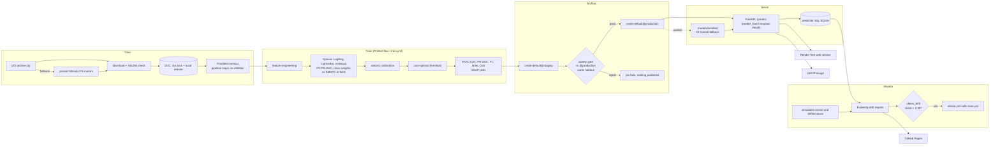

# credit-default-mlops

[](https://github.com/srini2k03/credit-default-mlops/actions/workflows/ci.yml)
[](https://github.com/srini2k03/credit-default-mlops/actions/workflows/train.yml)
[](https://github.com/srini2k03/credit-default-mlops/actions/workflows/pages.yml)

[](https://render.com/deploy?repo=https://github.com/srini2k03/credit-default-mlops)

A production-style ML system that predicts whether a credit-card customer will default next
month, and turns the prediction into an approve/decline decision that minimises expected cost
for the lender. It covers the full lifecycle: versioned, validated data; tuned and calibrated
models; a cost-based decision threshold; MLflow tracking and a model registry with a quality
gate; a FastAPI service with SHAP explanations; load testing; drift monitoring with automated
retraining; and CI/CD to GHCR, Render and GitHub Pages.

**Data:** [UCI Default of Credit Card Clients](https://archive.ics.uci.edu/dataset/350/default+of+credit+card+clients)
(Yeh & Lien, 2009; CC BY 4.0). 30,000 Taiwanese card holders, 23 features, 22.1% default rate.

## Live links

| What | Where |
|---|---|
| API (Swagger UI) | `https://credit-default-api.onrender.com/docs` (live after you click **Deploy to Render**; Render may add a suffix to the name if it is taken) |
| Monitoring and results site | https://srini2k03.github.io/credit-default-mlops/ (Evidently drift reports, metrics, gate, load test, MLflow summary and screenshots) |
| Container image | `ghcr.io/srini2k03/credit-default-mlops:latest` (pushed by `ci.yml` on every push to `main`) |

Render's free tier sleeps when idle, so the first request after a pause takes about 30-60 s.

## Results

<!-- RESULTS:START -->
Real UCI data (30,000 rows, default rate 22.1%), test holdout n = 6,000. Generated 2026-11-03T13:40:05Z by the [train workflow run](https://github.com/srini2k03/credit-default-mlops/actions/runs/41645854230) at commit `d2d7669`. Costs FN:FP = 5:1.

| Model | ROC-AUC | PR-AUC | F1 | Brier | Cost / applicant | Threshold |
|---|---|---|---|---|---|---|
| logreg | 0.740 | 0.478 | 0.471 | 0.143 | 0.601 | 0.13 |
| **lightgbm** (champion) | 0.778 | 0.536 | 0.488 | 0.135 | 0.562 | 0.13 |
| xgboost | 0.780 | 0.535 | 0.490 | 0.136 | 0.568 | 0.17 |

Champion at different decision thresholds (test holdout):

| Threshold rule | Threshold | Cost / applicant | Recall | Approval rate | F1 |
|---|---|---|---|---|---|
| cost-optimal | 0.13 | 0.562 | 0.766 | 0.526 | 0.488 |
| 0.5 | 0.50 | 0.759 | 0.347 | 0.886 | 0.458 |
| max-F1 | 0.39 | 0.619 | 0.524 | 0.792 | 0.539 |

Imbalance ablation (CV PR-AUC on the training split):

| Model | none | class_weight | smote |
|---|---|---|---|
| logreg | 0.515 | 0.513 | 0.514 |
| lightgbm | 0.564 | 0.564 | 0.560 |
| xgboost | 0.569 | 0.568 | 0.553 |
<!-- RESULTS:END -->

Full report: [`results/metrics.md`](results/metrics.md), quality gate:
[`results/gate.md`](results/gate.md), load test: [`results/loadtest.md`](results/loadtest.md)
(p50/p95/p99 per endpoint, filled by `train.yml`).

## Business framing

The model's job is a decision, not a score. Two errors have different prices:

- **False negative** (approve a customer who defaults): the bank loses the exposure at default
  times the loss given default (LGD).
- **False positive** (decline a customer who would have repaid): the bank loses the margin it
  would have earned on that customer.

Costs are set in [`configs/cost/default.yaml`](configs/cost/default.yaml) in relative units of
one lost margin: **FN = 5, FP = 1**. The ratio is an assumption, stated so it can be argued
with: as rough industry figures, card loss given default is 60-80% of the balance, while annual
net margin is 10-15% of it, which gives ratios between about 4:1 and 8:1. 5:1 sits at the
conservative end. Change one line of config, or pass `cost.fn_cost=8` on the command line, and
the whole pipeline re-optimises.

The **business cost** metric is the expected cost per applicant,
`(FN x 5 + FP x 1) / n`. With calibrated probabilities the theoretical optimum threshold is
`FP / (FP + FN) = 1/6 ≈ 0.17`; the pipeline still picks the threshold empirically on a
validation split (robust to residual miscalibration) and reports the cost-optimal threshold
next to the naive 0.5 and the max-F1 threshold, on the untouched test holdout. The
cost-vs-threshold curve is in `results/figures/cost_curve.png` after the first training run.

## Architecture



## How each part works

| Stage | Implementation |
|---|---|
| Ingest | `credit_default.data.download`: UCI archive zip first, then two pinned (commit-SHA) GitHub LFS mirrors (the original `.xls` and Kaggle's CSV re-export). Every source is normalised to one canonical CSV whose sha256 is pinned in `configs/data/uci.yaml` (both mirrors were checked to produce identical bytes; the UCI zip must match the same hash). Per-file checksums of the mirror downloads are verified too. |
| Versioning | `dvc.yaml` stage `download`; `dvc.lock` pins the data version. `make data` pulls from the DVC remote, or re-downloads and verifies, then pushes. |
| Validation | Pandera schema in `credit_default.validation`: column set (strict), dtypes, value domains (incl. the undocumented EDUCATION 0/5/6 and MARRIAGE 0 codes that exist in the real data), ranges, unique IDs, no nulls, default rate within bounds, minimum rows. Any violation raises and stops the pipeline before training. |
| Features | One `FeatureBuilder` step inside the model pipeline (utilisation, payment ratios, delay counts), so training and serving share code. |
| Models | Logistic regression, LightGBM, XGBoost. Optuna TPE (seeded) maximises stratified 3-fold CV PR-AUC on the training split; defaults are enqueued as trial 0. |
| Imbalance | `class_weight="balanced"` / `scale_pos_weight` vs **SMOTE inside the imblearn pipeline**, so oversampling only ever touches the training fold. Ablation table: none vs class weights vs SMOTE, per model family. |
| Calibration | Isotonic regression on a separate calibration split (`FrozenEstimator`), because class weights and SMOTE distort probabilities and the cost threshold needs real probabilities. Brier score before and after is reported. |
| Splits | Stratified, seeded: 60% train, 10% calibration, 10% validation (threshold and model selection), 20% test (reported metrics and the quality gate). |
| Selection | Champion = lowest expected cost on validation (PR-AUC breaks ties). |
| Tracking | MLflow: parent run plus one nested run per model family; params, metrics, figures, config and the model. |
| Registry | The deployable `ModelBundle` (calibrated pipeline + threshold + SHAP background + metadata) is logged as a pyfunc model and registered as `credit-default`. |
| Quality gate | `python -m credit_default.registry.gate`: re-scores the `@staging` challenger and the `@production` model on the same test holdout, each at its own threshold. Exit 1 if challenger PR-AUC < production − 0.005 or cost > production × 1.01. `tests/test_gate.py` proves a model trained on permuted labels is rejected. |
| Explainability | SHAP TreeExplainer (trees) or LinearExplainer (LogReg): global bar and beeswarm plots per run; top-k per-request contributions from `/explain` (log-odds of the base model before calibration; isotonic is monotone, so the direction of each contribution carries over). |
| Serving | FastAPI + Pydantic. Loads `models:/credit-default@production`; if no registry is reachable (5 s timeout, no retries) it falls back to `models/bundled/model.joblib`. Every prediction is appended to a SQLite log. |
| Monitoring | Evidently `DataDriftPreset` HTML reports for a control and a drifted slice (plus prediction drift); `check_drift` exits 1 above a 30% drifted-column share. |
| Orchestration | Prefect flow `flows/training_flow.py`: ingest → validate → train → evaluate (gate) → register (promote). Runs offline with Prefect's temporary local server. |

### MLflow aliases instead of stages

MLflow deprecated registry stages; this project uses aliases with the same meaning:

| Old stage | Alias | Set by |
|---|---|---|
| Staging | `@staging` | every training run (the challenger) |
| Production | `@production` | the quality gate, only when the challenger passes |

The API resolves `models:/credit-default@production`, so promotion and rollback are alias moves:
no redeploy of the service is needed when it is connected to a registry.

### Drift simulation (documented)

The UCI table has no timestamps, so "production traffic" is simulated from the test split
(`credit_default.monitor.simulate`, parameters in `configs/monitor/default.yaml`):

- **reference**: the training split;
- **control**: an untouched random sample of the test split, expected to show no drift;
- **drifted**: another test-split sample with deliberate population shifts: credit limits × 0.7,
  ages − 6 years (clipped to 21-79), PAY_0 one month worse for 35% of rows, bill amounts × 1.25.

Labels are dropped from both slices because production traffic arrives without outcomes. The
reports are published to GitHub Pages. `retrain.yml` checks the **control** slice on its weekly
schedule (expected: no drift, no retrain) and lets you pick the **drifted** slice on manual
dispatch to exercise the retrain path end to end. Retraining here re-runs training on the same
labelled data; in a real system it would include newly labelled outcomes. The same check works
on the API's prediction log: `python -m credit_default.monitor.check_drift --slice=log`.

## Design trade-offs

- **UCI dataset over Home Credit.** Home Credit is 2.7 GB and needs Kaggle credentials; UCI is
  2.9 MB, so CI, the load test and Render stay fast and need no secrets.
- **PR-AUC as the tuning objective, cost for selection.** PR-AUC is threshold-free and sensitive
  to the minority class; the decision itself is optimised on cost afterwards.
- **Separate calibration split instead of `CalibratedClassifierCV(cv=5)`.** One base model keeps
  SHAP explanations exact for the served model; the price is 10% fewer training rows.
- **Class weights by default, SMOTE as an ablation.** SMOTE adds synthetic neighbours in a space
  with discrete payment-status codes; the ablation reports whether it helps rather than
  assuming it.
- **The git repository is the durable record of production.** CI runners start with an empty
  MLflow store, so `train.yml` re-registers the committed bundle as `@production`
  (`registry.bootstrap`), gates the challenger against it, and commits the new bundle only when
  it passes. A persistent MLflow server (docker-compose) gives the same flow with history.
- **Render serves the committed, CI-trained artifact.** There is no public MLflow server, so the
  service runs with `MODEL_SOURCE=local`. If no model has been committed yet, the Render build
  (`scripts/render_build.sh`) trains a quick fallback on the real data (no tuning, no gate);
  once `train.yml` commits a gate-approved model, Render auto-deploys it.
- **DVC remote: local, persisted with `actions/cache`.** GitHub release assets cannot back a
  DVC remote: DVC stores content-addressed paths (`files/md5/ab/cdef...`), and release asset
  names cannot contain directories, and assets are not writable through DVC. Because the
  download is checksum-pinned and reproducible, a local remote (`.dvcstore/`, cached between
  workflow runs keyed on `dvc.lock`) is enough; swapping in S3/GCS is one `dvc remote add`.
- **SQLite prediction log.** Zero setup and fine for one instance; on Render's free tier the
  disk is ephemeral, so the log lives only as long as the instance. docker-compose mounts it on
  a volume.
- **Synthetic fixture for tests.** Tests and CI smoke runs never touch the network. The fixture
  has the exact UCI schema and real signal, but its metrics mean nothing and the publish step,
  the README updater and the run report all refuse or flag synthetic runs.

## Quickstart

```bash
python -m venv .venv && source .venv/bin/activate
make install                 # pip install -e ".[dev]"
make lint test               # ruff + pytest on the synthetic fixture (no network)

# Offline end-to-end on the synthetic fixture
make train-synthetic         # train, log to ./mlruns (SQLite), register @staging
make gate-synthetic          # gate vs @production, promote on pass
make flow-synthetic          # the same as a Prefect flow
make drift-synthetic         # Evidently reports in ./reports

# Real data (needs network access to UCI or GitHub)
make data                    # DVC pull, else download + verify + validate
make train gate              # full Optuna search, then the gate
make drift check-drift

# Serve
make serve                   # http://localhost:8000/docs
make smoke                   # curl every endpoint
make loadtest                # 60 s Locust run -> artifacts/loadtest.md

# Full local stack: MLflow :5000, API :8000, report server :8080
docker compose up -d --build
docker compose --profile train run --rm trainer   # real data: download + Prefect flow into the compose MLflow
docker compose --profile train run --rm trainer python flows/training_flow.py data=synthetic train=fast  # offline
```

### API

```bash
curl -s localhost:8000/health
curl -s -X POST localhost:8000/predict -H 'content-type: application/json' -d '{
  "LIMIT_BAL": 50000, "SEX": 2, "EDUCATION": 2, "MARRIAGE": 1, "AGE": 35,
  "PAY_0": 2, "PAY_2": 2, "PAY_3": 0, "PAY_4": 0, "PAY_5": 0, "PAY_6": 0,
  "BILL_AMT1": 46990, "BILL_AMT2": 48233, "BILL_AMT3": 49291, "BILL_AMT4": 28314,
  "BILL_AMT5": 28959, "BILL_AMT6": 29547, "PAY_AMT1": 2000, "PAY_AMT2": 2019,
  "PAY_AMT3": 1200, "PAY_AMT4": 1100, "PAY_AMT5": 1069, "PAY_AMT6": 1000}'
# -> probability_of_default, default_prediction, decision (approve/decline), threshold, model_version
curl -s -X POST 'localhost:8000/explain?top_k=5' -H 'content-type: application/json' -d @payload.json
```

| Endpoint | Purpose |
|---|---|
| `GET /health` | 200 with model source/version/threshold, 503 if no model is loaded |
| `POST /predict` | one application → calibrated probability and decision |
| `POST /predict_batch` | `{"applications": [...]}`, up to 1,000 |
| `POST /explain?top_k=5` | probability plus the top-k SHAP contributions |
| `GET /model` | metadata of the served model (commit, data checksum, test metrics) |

Invalid payloads (unknown fields, out-of-domain codes, missing fields) return 422.

## CI/CD

| Workflow | Trigger | What it does |
|---|---|---|
| `ci.yml` | push, PR | ruff, pytest, synthetic end-to-end smoke (train, gate, drift, Prefect flow), Docker build, container smoke test with curl, a short Locust run, push to GHCR on `main` (`GITHUB_TOKEN`) |
| `train.yml` | dispatch, called by `retrain.yml`, push to training code/config | real data via DVC/download → bootstrap `@production` from the committed bundle → Optuna training → quality gate (job fails on reject) → publish `results/`, `models/bundled/`, README table → build the image and run the recorded Locust load test → commit |
| `retrain.yml` | weekly schedule, dispatch | `check_drift` on a simulated slice; calls `train.yml` if the drift share exceeds the threshold |
| `pages.yml` | after `train`/`retrain`, push to `results/`, dispatch | real-data Evidently reports, results, MLflow summary, Playwright screenshots of the MLflow UI → `gh-pages` branch via `peaceiris/actions-gh-pages@v4` |

## Screenshots

Captured by `pages.yml` with Playwright from the MLflow store of the latest `train` run
(placeholders until that has run):

- MLflow experiment runs: https://srini2k03.github.io/credit-default-mlops/screenshots/mlflow-runs.png
- MLflow registry with `@staging` / `@production` aliases: https://srini2k03.github.io/credit-default-mlops/screenshots/mlflow-registry.png
- Evidently drift report (drifted slice): https://srini2k03.github.io/credit-default-mlops/reports/drift_drifted.html
- Cost-vs-threshold curve, reliability plot and SHAP plots: [`results/figures/`](results/figures/) (written by `train.yml`)

## Repository layout

```
configs/                 Hydra configs: data, train, cost, monitor, registry, model search spaces
src/credit_default/
  data/                  UCI download + checksums, synthetic fixture, schema, splits
  validation/            Pandera contract
  features/              feature engineering (inside the model pipeline)
  models/                pipeline factory, ModelBundle (deployable unit)
  tuning/                Optuna search, imbalance ablation
  threshold/             cost curve and threshold rules
  evaluate/              metrics and plots
  explain/               SHAP global plots
  registry/              MLflow helpers, quality gate, bootstrap
  serve/                 FastAPI app, schemas, model loader, prediction log
  monitor/               slice simulation, Evidently reports, check_drift
  pipeline/              train CLI, publish, run report
flows/                   Prefect flow
locust/                  load test and summary script
docker/                  API/train Dockerfile, MLflow Dockerfile, report server page
scripts/                 smoke test, Render build, site builder, screenshots, README updater
tests/                   pytest suite (synthetic fixture, no network)
results/                 committed outputs of train.yml (real data only)
models/bundled/          committed CI-trained model (fallback for serving)
dvc.yaml, dvc.lock       data versioning
docker-compose.yml       mlflow + api + reports (+ trainer profile)
render.yaml              Render blueprint (free web service)
```

## Dataset and licence

Yeh, I. C. & Lien, C. H. (2009). The comparisons of data mining techniques for the predictive
accuracy of probability of default of credit card clients. *Expert Systems with Applications*,
36(2), 2473-2480. Data from the UCI Machine Learning Repository, CC BY 4.0. Code: MIT.
