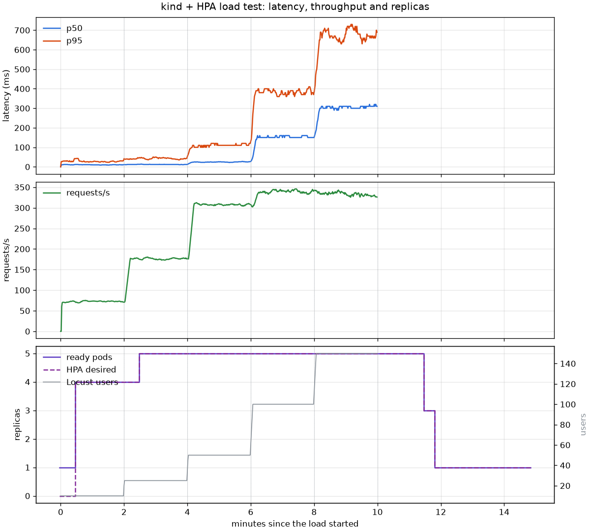

# kind + HPA load test

Generated 2026-11-22 06:06 UTC. Run 44990965540 on GitHub Actions (ubuntu-latest, X64), commit 6abb1be4b5ae2ca4290c9648060b06268a79b025.

Stepped Locust load (10, 25, 50, 100, 150 users, 120 s each, the user mix from `locust/locustfile.py`: /predict, /predict_batch of 20, /explain, /health) against the Helm chart on a single-node kind cluster. HPA 1-5 replicas at 50% CPU of a 250m request (1 CPU limit per pod), metrics-server at 15 s resolution, scale-down stabilisation 60 s. Load generator and cluster share one machine, so absolute numbers are a lower bound on what the service does on dedicated nodes.

## Per step

| Users | Requests/s | p50 (ms) | p95 (ms) | Failures | Peak ready pods | Peak CPU (% of request) |
|---:|---:|---:|---:|---:|---:|---:|
| 10 | 72.7 | 10 | 27 | 0.00% | 4 | 195 |
| 25 | 176.3 | 12 | 43 | 0.00% | 5 | 131 |
| 50 | 307.6 | 25 | 110 | 0.00% | 5 | 219 |
| 100 | 339.6 | 150 | 380 | 0.00% | 5 | 273 |
| 150 | 333.0 | 310 | 670 | 0.00% | 5 | 273 |

Per-step values use the samples after the first 20 s of each step: mean requests/s and the median of Locust's rolling-window percentiles.

## Scaling

- Ready pods: 1 at the start, peak 5 under load, 1 after the load stopped (reached 108 s after the last step).
- Time series: `replicas.csv` (every 10 s) and `loadtest_history.csv`; chart: `loadtest.png`.

## Whole run, per endpoint

| Endpoint | Requests | Failures | p50 (ms) | p95 (ms) | p99 (ms) |
|---|---:|---:|---:|---:|---:|
| /explain | 19649 | 0 | 95 | 410 | 560 |
| /health | 9765 | 0 | 19 | 250 | 380 |
| /predict | 98218 | 0 | 76 | 490 | 750 |
| /predict_batch (20) | 19706 | 0 | 87 | 500 | 760 |
| **all** | 147338 | 0 | 72 | 470 | 720 |

