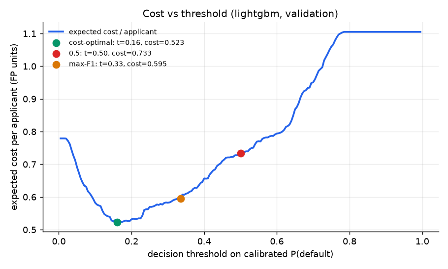
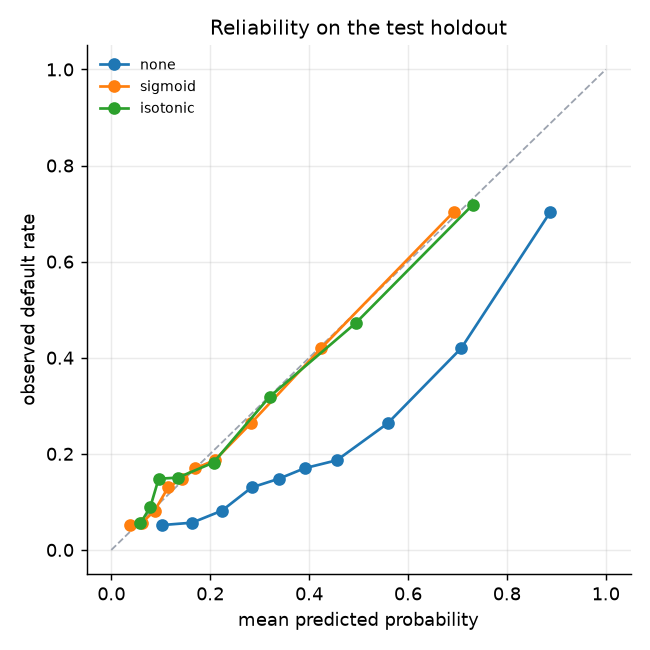
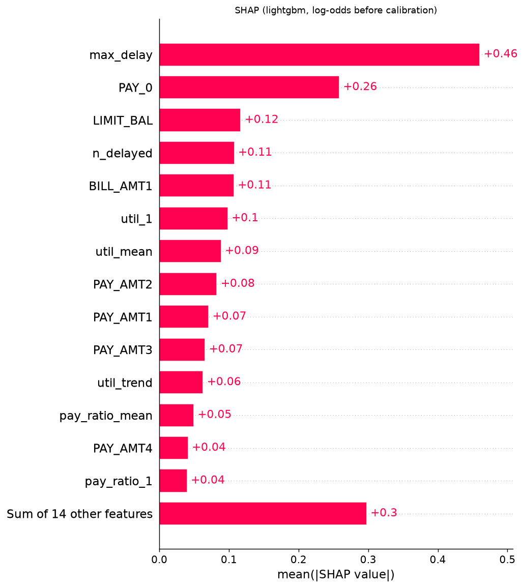
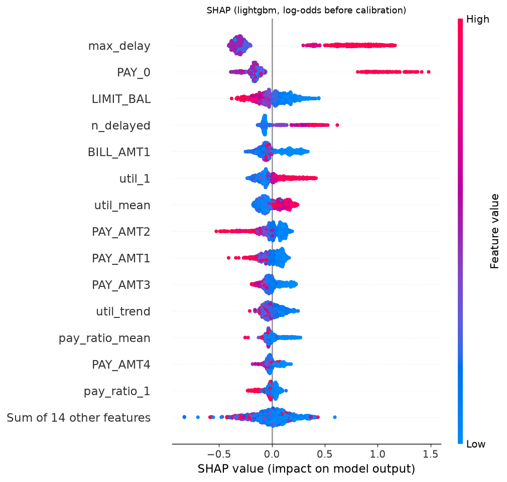

# Training run report

- Data: `uci` (30000 rows, default rate 0.221, sha256 `af6aa9d50511...`)
- Generated: 2026-11-24T11:18:56Z from commit `1faa0a8f8f`
- Splits: train 18000 / calibration 3000 / validation 3000 / test 6000
- Costs: FN = 5.0, FP = 1.0 (Bayes threshold for calibrated scores = 0.167)
- Imbalance handling: `class_weight`; champion: **lightgbm** (calibration: sigmoid)
- Excluded model inputs: SEX, MARRIAGE, AGE
- Selection rule: lowest expected cost per applicant on validation among deployable families; validation PR-AUC breaks ties

## Test holdout, all families (threshold = each model's cost-optimal threshold from validation)

| Model | CV PR-AUC (train) | CV std | ROC-AUC | PR-AUC | F1 | Brier | Cost / applicant | Threshold | Recall | Approval rate | Precision | Specificity | Balanced acc. | Log loss | ECE | TP | FP | TN | FN | Calibration | Brier before calibration | Optuna trials |
|---|---|---|---|---|---|---|---|---|---|---|---|---|---|---|---|---|---|---|---|---|---|---|
| logreg | 0.5123 | 0.0145 | 0.7331 | 0.4739 | 0.4587 | 0.1435 | 0.6198 | 0.1100 | 0.7302 | 0.5170 | 0.3344 | 0.5872 | 0.6587 | 0.4552 | 0.0142 | 969 | 1929 | 2744 | 358 | isotonic | 0.1951 | 30 |
| random_forest | 0.5668 | 0.0070 | 0.7788 | 0.5551 | 0.4825 | 0.1357 | 0.5617 | 0.1450 | 0.7875 | 0.4992 | 0.3478 | 0.5806 | 0.6840 | 0.4314 | 0.0188 | 1045 | 1960 | 2713 | 282 | sigmoid | 0.1770 | 30 |
| lightgbm | 0.5647 | 0.0080 | 0.7807 | 0.5594 | 0.4880 | 0.1346 | 0.5578 | 0.1600 | 0.7769 | 0.5170 | 0.3558 | 0.6005 | 0.6887 | 0.4287 | 0.0146 | 1031 | 1867 | 2806 | 296 | sigmoid | 0.1766 | 30 |
| xgboost | 0.5679 | 0.0076 | 0.7797 | 0.5549 | 0.5025 | 0.1357 | 0.5685 | 0.1700 | 0.7076 | 0.5983 | 0.3896 | 0.6852 | 0.6964 | 0.4313 | 0.0199 | 939 | 1471 | 3202 | 388 | sigmoid | 0.1824 | 30 |
| catboost (not deployable) | 0.5658 | 0.0082 | 0.7823 | 0.5631 | 0.5045 | 0.1352 | 0.5593 | 0.1700 | 0.7227 | 0.5875 | 0.3875 | 0.6756 | 0.6991 | 0.4299 | 0.0212 | 959 | 1516 | 3157 | 368 | sigmoid | 0.1775 | 30 |

## 95% bootstrap intervals on the test holdout (stratified, resampled rows)

| Model | ROC-AUC | PR-AUC | Brier | Cost / applicant | Recall |
|---|---|---|---|---|---|
| logreg | 0.7331 [0.7157, 0.7495] | 0.4739 [0.4497, 0.5000] | 0.1435 [0.1395, 0.1475] | 0.6198 [0.5915, 0.6505] | 0.7302 [0.7057, 0.7532] |
| random_forest | 0.7788 [0.7646, 0.7934] | 0.5551 [0.5302, 0.5812] | 0.1357 [0.1316, 0.1395] | 0.5617 [0.5368, 0.5891] | 0.7875 [0.7649, 0.8075] |
| lightgbm | 0.7807 [0.7665, 0.7948] | 0.5594 [0.5337, 0.5853] | 0.1346 [0.1308, 0.1384] | 0.5578 [0.5323, 0.5838] | 0.7769 [0.7558, 0.7984] |
| xgboost | 0.7797 [0.7655, 0.7944] | 0.5549 [0.5285, 0.5810] | 0.1357 [0.1317, 0.1394] | 0.5685 [0.5413, 0.5948] | 0.7076 [0.6854, 0.7299] |
| catboost | 0.7823 [0.7680, 0.7964] | 0.5631 [0.5377, 0.5877] | 0.1352 [0.1312, 0.1389] | 0.5593 [0.5323, 0.5877] | 0.7227 [0.6993, 0.7449] |

## Threshold rules for the champion (test holdout)

| Rule | ROC-AUC | PR-AUC | F1 | Brier | Cost / applicant | Threshold | Recall | Approval rate |
|---|---|---|---|---|---|---|---|---|
| cost-optimal | 0.7807 | 0.5594 | 0.4880 | 0.1346 | 0.5578 | 0.1600 | 0.7769 | 0.5170 |
| 0.5 | 0.7807 | 0.5594 | 0.4640 | 0.1346 | 0.7523 | 0.5000 | 0.3542 | 0.8835 |
| max-F1 | 0.7807 | 0.5594 | 0.5344 | 0.1346 | 0.6292 | 0.3340 | 0.5117 | 0.7977 |

## Calibration of the champion (lightgbm): fitted on the calibration split, chosen on validation Brier

| Method | Val Brier | Val log loss | Val ECE | Test Brier | Test log loss | Test ECE | Test ROC-AUC | Test PR-AUC | Test cost | Cutoff |
|---|---|---|---|---|---|---|---|---|---|---|
| none | 0.1702 | 0.5191 | 0.1842 | 0.1766 | 0.5346 | 0.1902 | 0.7807 | 0.5594 | 0.5625 | 0.3750 |
| sigmoid (chosen) | 0.1312 | 0.4190 | 0.0172 | 0.1346 | 0.4287 | 0.0146 | 0.7807 | 0.5594 | 0.5578 | 0.1600 |
| isotonic | 0.1323 | 0.4334 | 0.0219 | 0.1348 | 0.4399 | 0.0192 | 0.7806 | 0.5338 | 0.5580 | 0.1800 |

## Imbalance ablation (CV PR-AUC on the training split, same hyper-parameters)

| Model | Strategy | CV PR-AUC | Std |
|---|---|---|---|
| logreg | none | 0.5126 | 0.0151 |
| logreg | class_weight | 0.5123 | 0.0145 |
| logreg | smote | 0.5135 | 0.0144 |
| random_forest | none | 0.5667 | 0.0081 |
| random_forest | class_weight | 0.5668 | 0.0070 |
| random_forest | smote | 0.5543 | 0.0052 |
| lightgbm | none | 0.5630 | 0.0087 |
| lightgbm | class_weight | 0.5647 | 0.0080 |
| lightgbm | smote | 0.5591 | 0.0055 |
| xgboost | none | 0.5674 | 0.0075 |
| xgboost | class_weight | 0.5679 | 0.0076 |
| xgboost | smote | 0.5489 | 0.0048 |
| catboost | none | 0.5635 | 0.0086 |
| catboost | class_weight | 0.5658 | 0.0082 |
| catboost | smote | 0.5579 | 0.0049 |

## Figures

