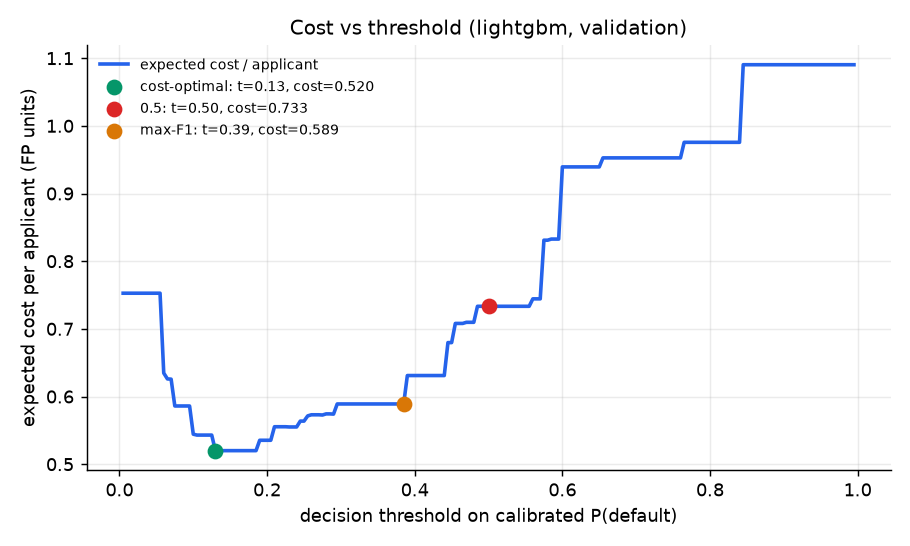
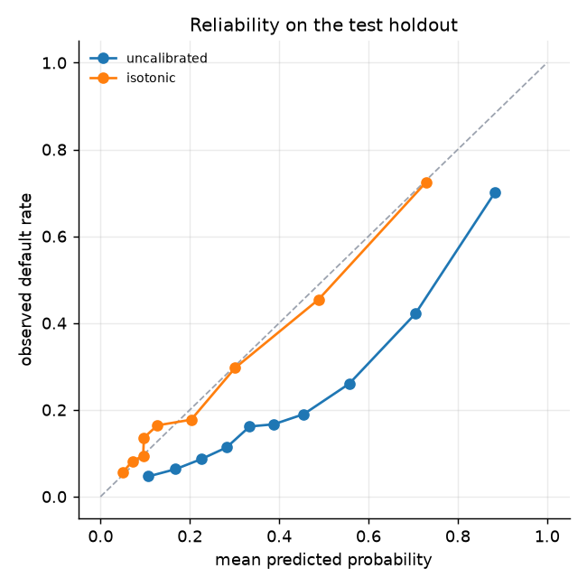
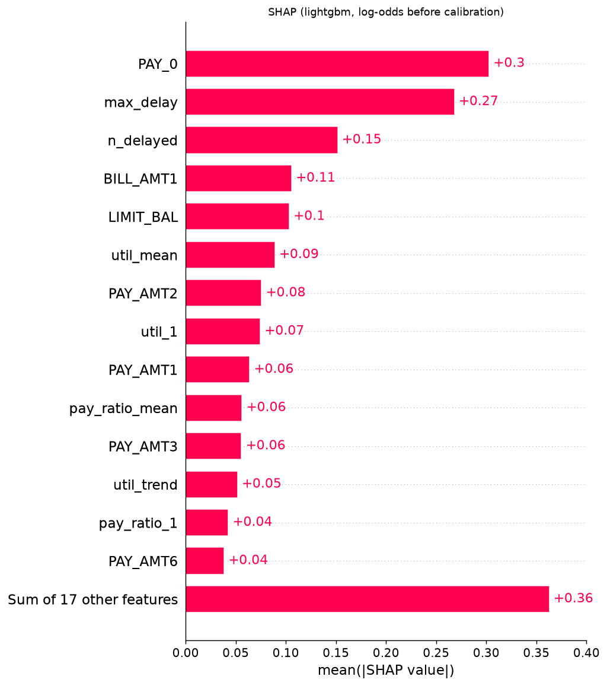
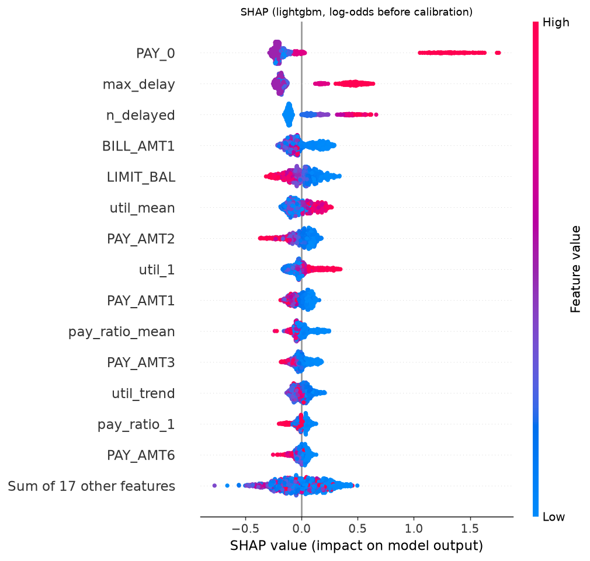

# Training run report

- Data: `uci` (30000 rows, default rate 0.221, sha256 `af6aa9d50511...`)
- Generated: 2026-11-03T13:40:05Z from commit `d2d766943e`
- Splits: train 18000 / calibration 3000 / validation 3000 / test 6000
- Costs: FN = 5.0, FP = 1.0 (Bayes threshold for calibrated scores = 0.167)
- Imbalance handling: `class_weight`; champion: **lightgbm**

## Test holdout, all families (threshold = each model's cost-optimal threshold from validation)

| Model | CV PR-AUC (train) | ROC-AUC | PR-AUC | F1 | Brier | Cost / applicant | Threshold | Recall | Approval rate | Brier before calibration | Optuna trials |
|---|---|---|---|---|---|---|---|---|---|---|---|
| logreg | 0.5133 | 0.7403 | 0.4782 | 0.4714 | 0.1431 | 0.6012 | 0.1300 | 0.7295 | 0.5367 | 0.1938 | 30 |
| lightgbm | 0.5640 | 0.7781 | 0.5362 | 0.4879 | 0.1353 | 0.5625 | 0.1300 | 0.7664 | 0.5263 | 0.1763 | 30 |
| xgboost | 0.5683 | 0.7799 | 0.5351 | 0.4897 | 0.1358 | 0.5682 | 0.1700 | 0.7468 | 0.5467 | 0.1814 | 30 |

## Threshold rules for the champion (test holdout)

| Rule | ROC-AUC | PR-AUC | F1 | Brier | Cost / applicant | Threshold | Recall | Approval rate |
|---|---|---|---|---|---|---|---|---|
| cost-optimal | 0.7781 | 0.5362 | 0.4879 | 0.1353 | 0.5625 | 0.1300 | 0.7664 | 0.5263 |
| 0.5 | 0.7781 | 0.5362 | 0.4582 | 0.1353 | 0.7593 | 0.5000 | 0.3466 | 0.8865 |
| max-F1 | 0.7781 | 0.5362 | 0.5394 | 0.1353 | 0.6192 | 0.3868 | 0.5237 | 0.7917 |

## Imbalance ablation (CV PR-AUC on the training split, same hyper-parameters)

| Model | Strategy | CV PR-AUC | Std |
|---|---|---|---|
| logreg | none | 0.5149 | 0.0125 |
| logreg | class_weight | 0.5133 | 0.0115 |
| logreg | smote | 0.5141 | 0.0121 |
| lightgbm | none | 0.5637 | 0.0070 |
| lightgbm | class_weight | 0.5640 | 0.0077 |
| lightgbm | smote | 0.5602 | 0.0040 |
| xgboost | none | 0.5690 | 0.0088 |
| xgboost | class_weight | 0.5683 | 0.0087 |
| xgboost | smote | 0.5532 | 0.0042 |

## Figures

